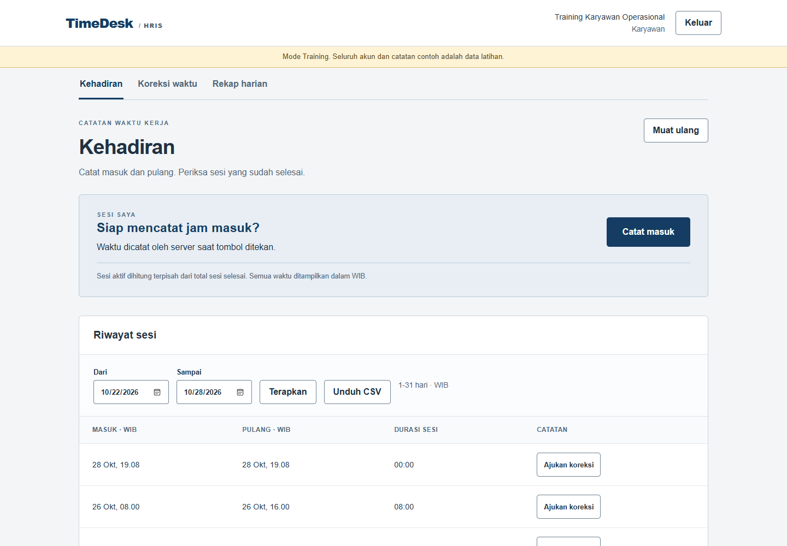
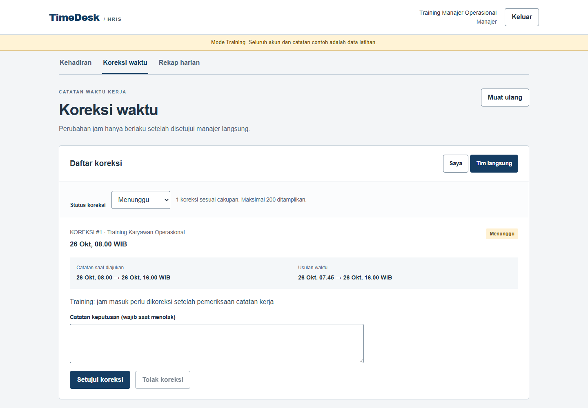
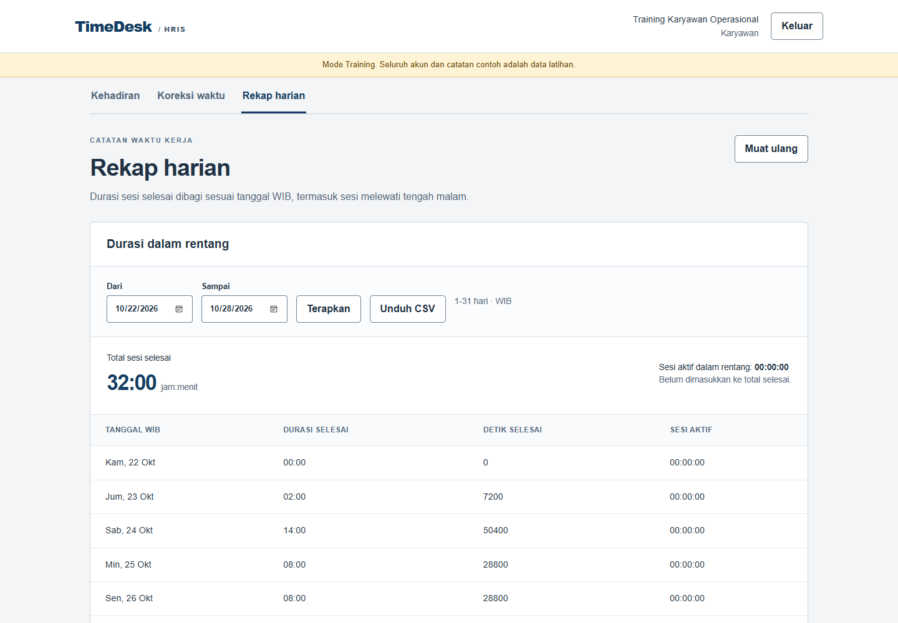
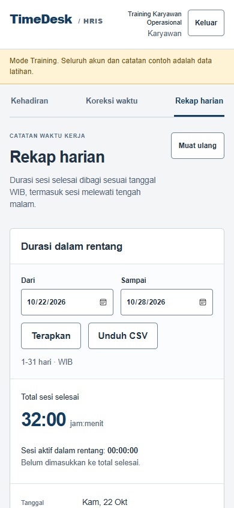

# TimeDesk HRIS

TimeDesk mencatat jam masuk dan pulang karyawan, membagi durasi per tanggal WIB, dan meninjau koreksi melalui manajer langsung. Waktu pencatatan berasal dari server. Karyawan tidak dapat mengirim timestamp pengganti pada endpoint masuk atau pulang.

Proyek ini merupakan prototipe teknis portfolio. Data Training bersifat sintetis. Aplikasi tidak menghitung gaji atau ketentuan lembur, tidak merekam lokasi, dan tidak menggunakan biometrik.

## Tampilan

Screenshot berasal dari aplikasi yang dijalankan dengan data Training.





<details><summary>Rekap harian dan tampilan ponsel</summary>





</details>

## Menjalankan secara lokal

Persyaratan: Windows PowerShell, Docker Desktop dengan Linux containers, dan ruang kosong untuk image PostgreSQL serta backend/frontend.

```powershell
git clone https://github.com/zalamanga/timedesk-hris.git
cd timedesk-hris
.\scripts\Start.ps1
```

Buka **http://localhost:8095**. Skrip menyiapkan konfigurasi lokal dan menulis sandi demo ke `.local/LOCAL-CREDENTIALS.txt`. File tersebut hanya untuk komputer Anda, jangan dimasukkan ke GitHub.

| Akun Training | Peran dan cakupan |
| --- | --- |
| `employee@timedesk.test` | Kehadiran dan koreksi milik sendiri |
| `colleague@timedesk.test` | Karyawan lain di bawah manajer pertama |
| `manager@timedesk.test` | Kehadiran sendiri dan peninjauan dua bawahan langsung |
| `manager2@timedesk.test` | Manajer cabang kedua |
| `second@timedesk.test` | Karyawan di bawah manajer cabang kedua |

Semua akun menggunakan sandi demo privat yang disiapkan skrip. Tidak ada sandi tetap di source. Seed hanya berjalan ketika mode demo diaktifkan dan tidak mengatur ulang akun atau data pada startup berikutnya.

Untuk berhenti tanpa menghapus data:

```powershell
.\scripts\Stop.ps1
```

## Alur yang dapat dicoba

1. Masuk sebagai karyawan dan tekan **Catat masuk**. Server membuat satu sesi aktif. Tekan **Catat pulang** untuk menyelesaikannya.
2. Pilih sesi selesai, lalu **Ajukan koreksi**. Isikan usulan masuk/pulang dalam WIB dan alasan minimal 10 karakter. Catatan asli belum berubah.
3. Masuk sebagai manajer pertama. Buka **Koreksi waktu → Tim langsung**. Bandingkan interval asli dan usulan, lalu setujui atau tolak dengan alasan.
4. Buka **Rekap harian**. Sesi melewati tengah malam dibagi pada masing-masing tanggal WIB. Total selesai dan durasi aktif ditampilkan terpisah.
5. Unduh CSV sesuai rentang tanggal dan cakupan yang dipilih. Ekspor tidak memasukkan alasan koreksi.

## Aturan penting

- Satu sesi aktif per karyawan dijaga dengan row lock dan partial unique index di database.
- `request_id` UUID mewakili satu niat masuk. Pengiriman ulang dengan UUID yang sama mengembalikan catatan yang sama, termasuk apabila sesi itu sudah selesai.
- Pulang dan keputusan koreksi memerlukan `expected_version`. Konflik mengembalikan HTTP 409; UI menyimpan draf dan meminta muat ulang.
- Interval selesai hanya berubah melalui koreksi yang disetujui. Snapshot timestamp asli tersimpan pada setiap koreksi. Persetujuan, perubahan interval, versi, dan audit sebelum/sesudah berada dalam satu transaksi.
- Koreksi hanya dapat diajukan untuk sesi selesai, berdurasi lebih dari 0 hingga 24 jam, dan tidak berakhir di masa depan. Persetujuan memeriksa ulang versi serta tabrakan interval.
- Interval memakai `[mulai, selesai)`: dua sesi yang saling bersebelahan diperbolehkan, interval bertumpang tindih ditolak.
- Manajer hanya dapat membuka bawahan langsung. Catatan di luar cakupan mengembalikan 404; daftar, jumlah, rekap, detail, dan CSV memakai cakupan yang sama.
- Rentang tanggal maksimal 31 hari pada tahun 2000-2200. Cakupan tim maksimal 500 karyawan; rekap dan CSV maksimal 10.000 entry setelah filter. Data melebihi batas ditolak dengan 422 dan perlu dipersempit.
- Sesi login berupa opaque token yang disimpan dalam bentuk hash di database. Cookie HttpOnly, SameSite=Lax, validasi CSRF/Origin, serta pembatasan percobaan login digunakan bersama.

## Stack dan peta kode

FastAPI, SQLAlchemy, Alembic, PostgreSQL 17, React, TypeScript, Vite, Docker Compose, pytest, Vitest, dan Playwright. Versi paket Python dan JavaScript dikunci dalam requirements serta lockfile.

```text
backend/app/
  models.py       User, Attendance, Correction, Event, Session
  main.py         Auth, cakupan data, transaksi, API dan CSV
  intervals.py    Konversi rentang WIB, clipping durasi
  schemas.py      Validasi input API
  seed.py         Dataset Training yang idempotent
  cli.py          Migrasi, seed dan pembuatan akun
backend/alembic/  Migrasi awal dan riwayat skema
backend/tests/    Pengujian API, aturan, rollback dan race PostgreSQL
frontend/src/    UI, typed API dan pengujian formatter
e2e/             Pengujian browser dan capture screenshot
```

- [Arsitektur dan batas transaksi](docs/ARCHITECTURE.md)
- [Panduan file dan fungsi](docs/CODE-GUIDE.md)
- [Panduan menjalankan demo dan menjelaskan saat interview](docs/INTERVIEW.md)
- [Verifikasi dan batas pengujian](docs/VERIFICATION.md)
- [Keputusan desain](DESIGN.md)

## Pengembangan dan pengujian

Untuk Python lokal, buat virtual environment pengujian dari root repo:

```powershell
python -m venv .venv
.\.venv\Scripts\Activate.ps1
python -m pip install -r backend/requirements-dev.txt
python -m pytest -q
npm --prefix frontend ci
npm --prefix frontend test
npm --prefix frontend run build
```

Tanpa `APP_TEST_DATABASE_URL`, tes backend memakai SQLite sementara; tes race PostgreSQL dilewati. Untuk bukti locking nyata, arahkan `APP_TEST_DATABASE_URL` ke **database test terpisah** yang namanya mengandung `test`. Fixture menghapus dan membuat ulang tabel pada database test tersebut. Jangan gunakan database aplikasi.

Untuk browser, jalankan aplikasi terlebih dahulu dan gunakan sandi demo lokal:

```powershell
npm ci
$env:APP_BASE_URL = "http://127.0.0.1:8095"
$env:APP_DEMO_PASSWORD = "<sandi dari file lokal>"
npm run test:e2e
```

Sandi hanya dibaca dari environment. Ganti placeholder tersebut; jangan menyimpannya di source. Playwright lokal memakai Microsoft Edge, sedangkan CI memakai Chromium. Set `PLAYWRIGHT_CHANNEL` bila ingin memilih channel browser lain yang sudah terpasang.

API interaktif tersedia di **http://localhost:8095/api/docs** setelah server menyala. Dokumentasi API tidak menonaktifkan kewajiban cookie sesi dan CSRF.

## Sebelum penggunaan nyata

Prototipe memakai satu organisasi dan relasi bawahan langsung. Belum ada pengaturan shift, kalender libur, break, mobile offline, payroll, sinkronisasi mesin absensi, ataupun pengelolaan hubungan manajer melalui UI. Sesi aktif yang lupa ditutup harus diselesaikan, kemudian diajukan koreksi. Batas 24 jam berlaku untuk usulan koreksi, bukan pemotongan otomatis sesi aktif.

Gunakan HTTPS dan `APP_COOKIE_SECURE=true` pada deployment nyata. Matikan mode demo dan seed, siapkan akun melalui CLI, lindungi database, dan tentukan kebijakan privasi serta penyimpanan data organisasi sebelum memakai data karyawan.
