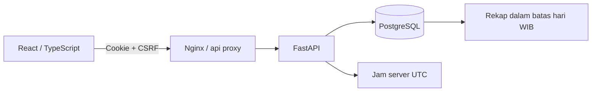
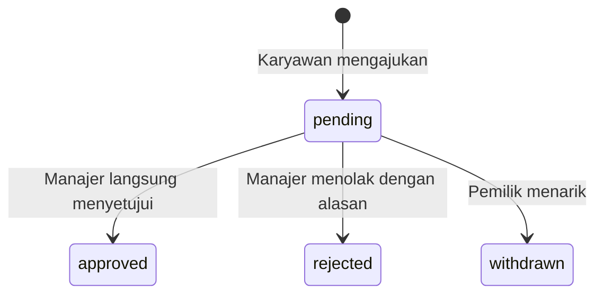

# Arsitektur TimeDesk

## Jalur permintaan

Frontend mengirim perintah, bukan waktu clock-in/out. Backend menggunakan jam UTC yang diinjeksi melalui `create_app(..., clock=...)`; ini membuat pengujian jam konsisten tanpa menerima timestamp dari pengguna. Tampilan dan batas tanggal menggunakan `Asia/Jakarta`.

## Data

| Tabel | Peran |
| --- | --- |
| `users` | Identitas, hash sandi, peran, `manager_id`, status aktif |
| `attendance` | Interval asli/terkini, UUID intent masuk, versi |
| `corrections` | Usulan interval, alasan, snapshot versi catatan, status dan keputusan |
| `events` | Audit masuk, pulang, pengajuan, serta keputusan |
| `sessions` | Hash opaque token, token CSRF dan masa berlaku |
| `rate_limit_buckets` | Penghitung upsert per email dan peer dalam jendela 15 menit |
| `seed_markers` | Penanda bahwa dataset Training telah diterapkan |

`uq_one_active_entry` adalah partial unique index pada `employee_id WHERE end_at IS NULL`. PostgreSQL hanya mengindeks baris yang memenuhi predikat tersebut, sehingga satu karyawan dapat memiliki banyak sesi selesai dan tepat satu sesi aktif. [Dokumentasi PostgreSQL: partial indexes](https://www.postgresql.org/docs/17/indexes-partial.html).

## Urutan lock dan idempotency

Seluruh jalur mutasi kehadiran mengunci **User → Attendance → Correction**, sesuai baris yang diperlukan. Lock User menjadi titik serialisasi untuk setiap karyawan; karyawan lain tetap dapat bekerja secara independen. SQLAlchemy `with_for_update()` menerbitkan `SELECT ... FOR UPDATE` di PostgreSQL. Setelah menunggu lock, `populate_existing=True` menyegarkan nilai yang mungkin sudah ada dalam identity map. [Dokumentasi SQLAlchemy: selectable / with_for_update](https://docs.sqlalchemy.org/en/21/core/selectable.html).

Clock-in memeriksa ulang UUID intent setelah memperoleh lock. Retry dengan UUID lama mengembalikan representasi catatan terkini (200), tidak membuat sesi baru. UUID baru membuat sesi baru (201) hanya jika tidak ada sesi aktif. Unique constraint `(employee_id, request_id)` dan partial unique index menjadi penjagaan tambahan di database.

Clock-out memeriksa kepemilikan, versi, status aktif, serta `now > start_at`. Waktu akhir, kenaikan versi dan event disimpan pada commit yang sama.

## Koreksi sebagai transaksi

Saat pengajuan, `base_entry_version` merekam versi interval yang ditinjau, sedangkan `original_start`/`original_end` menyimpan timestamp aslinya. Snapshot tidak diganti ketika koreksi disetujui atau entry dikoreksi lagi. Riwayat UI menggunakan snapshot ini. Hanya satu koreksi pending diperbolehkan untuk setiap entry. Pengajuan tidak mengubah interval.

Persetujuan memeriksa ulang versi koreksi, status pending, snapshot versi entry, jam akhir dan tabrakan dengan sesi lain, termasuk sesi aktif. Jika lolos, backend mengubah interval, menaikkan versi entry dan koreksi, menulis identitas/waktu keputusan, serta menambah audit dengan timestamp tepat sebelum/sesudah dalam satu transaksi. Kegagalan audit membatalkan perubahan interval dan keputusan. Penolakan/penarikan tidak mengubah interval.

Interval bertabrakan bila `other.start < proposed.end AND (other.end IS NULL OR other.end > proposed.start)`. Perbandingan ketat memungkinkan sesi yang bersebelahan. Nilai `end_at IS NULL` diperlakukan sebagai interval terbuka hingga masa depan untuk pemeriksaan tabrakan.

## Privasi dan auth

Pemilik dapat melihat data sendiri. Manajer hanya dapat melihat `employee.manager_id == manager.id`, bukan seluruh organisasi. Detail di luar cakupan mengembalikan 404. Query daftar, jumlah, rekap, dan ekspor membatasi employee IDs sejak awal. Alasan koreksi tidak dimasukkan ke CSV atau rekap tim.

Login memverifikasi Argon2id. Token sesi acak dikirim lewat cookie HttpOnly `timedesk_session`, path `/api`, SameSite=Lax; database menyimpan SHA-256 token. Setiap mutasi membutuhkan header `X-CSRF-Token`, Origin harus cocok dengan daftar asal bila dikirim, dan `Sec-Fetch-Site: cross-site` ditolak. Header proxy `X-Forwarded-For` tidak langsung dipercaya untuk limiter. Batas payload 64 KiB dan input strict melarang field timestamp tersembunyi pada clock-in/out.

Pembatasan login adalah fixed window per email (8 percobaan) dan peer (64 percobaan) selama 15 menit. Penghitung disimpan di DB dan diperbarui dengan upsert, bukan memory setiap worker. Sistem ini belum merupakan solusi deteksi penyalahgunaan terdistribusi secara menyeluruh.

## Durasi dan batas hari

Rentang tanggal inklusif, maksimal 31 hari pada tahun 2000-2200. Batas tahun diperiksa sebelum penambahan hari, sehingga tanggal `9999-12-31` ditolak dengan 422 dan tidak memicu overflow. `window()` membentuk `[00:00 hari pertama WIB, 00:00 setelah hari terakhir WIB)` lalu mengonversinya ke UTC. `clip_seconds()` menjumlahkan irisan interval, bukan seluruh durasi pada hari masuk.

Cakupan tim dibatasi maksimal 500 karyawan. Bila `employee_id` diberikan, filtering karyawan tersebut dijalankan sebelum cap tim. Rekap dan CSV membaca maksimal 10.001 row untuk memeriksa batas 10.000 entry; hasil yang melampaui batas ditolak dengan 422 dan instruksi mempersempit filter, tidak diam-diam dipotong. Pengelompokan entry per karyawan dilakukan sekali sebelum iterasi tanggal.

Contoh sesi 28 Oktober 23:00 sampai 29 Oktober 03:00 WIB: rekap tanggal 28 adalah 3.600 detik dan tanggal 29 adalah 10.800 detik. Sesi aktif memakai jam server terkini, tetapi durasinya dipisahkan dari total selesai. `HH:MM` membuang pecahan menit hanya untuk tampilan; `completed_seconds` tetap tersedia.

## Batas penerapan

SQLite dipakai untuk pengujian cepat, bukan bukti row locking produksi. Tiga tes race harus dijalankan pada PostgreSQL. Layanan tidak menyediakan API untuk edit langsung, mengganti manager, menghapus audit, atau mengubah waktu client. Relasi manajer saat ini ditetapkan oleh CLI/seed dan tidak memiliki riwayat efektif tanggal. Ini perlu dirancang sebelum penggunaan organisasi nyata.
